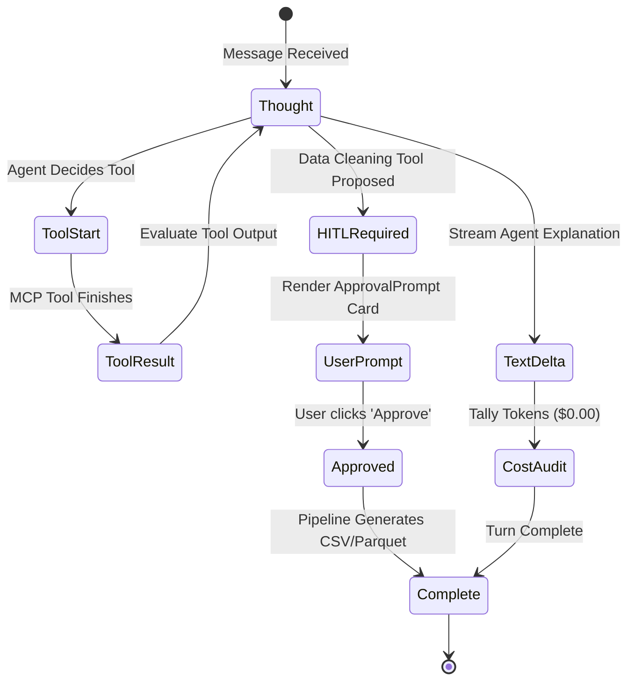

# GEMINI.md — Antigravity & Gemini Specific Overrides

This document defines Antigravity IDE workflows, Google Gemini model configurations, and runtime overrides tailored for the **Autonomous ML Research Agent (AMRA)** workspace.

---

## 1. Antigravity Environment & Model Configuration

- **Target Model:** Google Gemini 2.5 Flash (Cloud Primary) / Gemini 3.8 Flash.
- **Provider Architecture:** Google AI Studio / Gemini API Free Tier (15 RPM, 1M TPM, 1,500 requests/day).
- **Environment Context:** Windows 11 host with PowerShell execution environment.
- **Operating Cost Target:** **$0.00 / month** (all capabilities engineered to function entirely within free quotas).

### Key Model Advantages Utilized:
1. **1,000,000+ Token Context Window:** AMRA leverages Gemini's massive context window to ingest entire tabular schemas, sample data rows, paper abstracts, and full multi-turn research conversations without truncation.
2. **Sub-1.5s Time-to-First-Token (TTFT):** Gemini 2.5 Flash powers real-time SSE streaming for live "thought" disclosures and instant user interaction.
3. **Structured Tool Calling:** Native JSON-schema tool dispatch integrated into the agent orchestration loop.

---

## 2. Antigravity-Specific Operational Guidelines

### 2.1 Tool Execution & PowerShell Guidelines (Windows)
- When executing terminal commands via `run_command`:
  - Shell is **PowerShell** on **Windows**.
  - Always use PowerShell-compatible syntax (e.g., `Get-ChildItem`, `Test-Path`, `Copy-Item`, `python -m`, `pip install`).
  - Use forward slashes (`/`) or escaped backslashes (`\\`) in paths to prevent escape-character truncation.
  - Do not assume Unix-only utilities (`grep`, `cat`, `sed`) are installed; prefer native PowerShell cmdlets (`Select-String`, `Get-Content`) or Python scripts.

### 2.2 Artifacts Management
- Store comprehensive analysis reports, architecture diagrams, benchmark verification results, and diff plans in the artifact directory (`<appDataDir>\brain\<conversation-id>`).
- Format all artifacts with GitHub Flavored Markdown and standard Mermaid diagrams (`flowchart TD`, `sequenceDiagram`, `stateDiagram-v2`).
- Do not re-summarize entire artifacts in conversational responses; instead provide clear pointers and highlight pending decision points.

### 2.3 Documentation Hub (`docx/`)
- All persistent project documentation must be maintained in both the workspace root and synced to the `docx/` folder.
- Keep the following documents up to date whenever features or schemas change:
  - `docx/AGENTS.md` & `AGENTS.md`
  - `docx/GEMINI.md` & `GEMINI.md`
  - `docx/BRIEF.md` & `BRIEF.md`
  - `docx/product.md` & `product.md`
  - `docx/ui.md` & `ui.md`
  - `docx/engineering.md` & `engineering.md`
  - `docx/PRD_v2.md` & `docx/TRD_v2.md`

---

## 3. AMRA Server-Sent Events (SSE) Protocol

When extending or interacting with the streaming backend (`POST /api/chat/stream` and `POST /api/chat/approve`), Antigravity must preserve the exact event structure:



### Event Payload Contracts:
- `thought`: Internal reasoning steps rendered in the collapsible UI disclosure box.
- `tool_start`: Emitted before executing `search_academic_papers`, `find_kaggle_datasets`, or `clean_tabular_dataset`.
- `tool_result`: Carries structured paper/dataset records for card rendering.
- `hitl_required`: Emitted when local disk write or cleaning is required; contains cryptographic `approval_token`.
- `text_delta`: Real-time streaming response chunks.
- `cost_audit`: Token usage report confirming free-tier metrics.
- `complete`: Signals end of SSE stream for session update.
- `error`: Structured error event with diagnostic details.

---

## 4. Benchmark Enforcement & Verification

Antigravity must never conclude a code modification turn without validating against the project benchmark test suite:

```powershell
# 1. Run Cloudflare Edge Caching & Load Burst Benchmark
python tests/test_cloudflare_caching.py

# 2. Run Multi-Tenant Database & User Authentication Benchmark
python tests/test_auth_database.py

# 3. Run Multi-Source Discovery Benchmark (OpenAlex + Hugging Face)
python tests/test_multi_source.py

# 4. Run MCP Execution & Security Benchmark
python tests/test_phase1_production.py

# 5. Run FastAPI Middleware & SSE Router Benchmark
python tests/test_phase2_backend.py

# 6. Run DevSecOps, Path Traversal & HITL Security Benchmark
python tests/test_phase4_security_devops.py
```

### Benchmark Metrics:
- **BR-01 Schema Contracts:** Pydantic models validate 100% of inputs and outputs.
- **BR-02 Edge Resilience:** Null values, special characters, and corrupted files are handled without crashes.
- **BR-03 Zero Link Hallucination:** arXiv PDF links must match `https://arxiv.org/pdf/{id}.pdf`.
- **BR-04 Latency SLA:** Cache hits `< 15ms`; dataset cleaning `< 500ms`.
- **BR-05 Security:** Zero directory traversal escapes outside `data/raw` or `processed_data`.
- **BR-06 Health Math:** Data Health Score must be bounded in $[0.0, 100.0]$ with valid delta.
