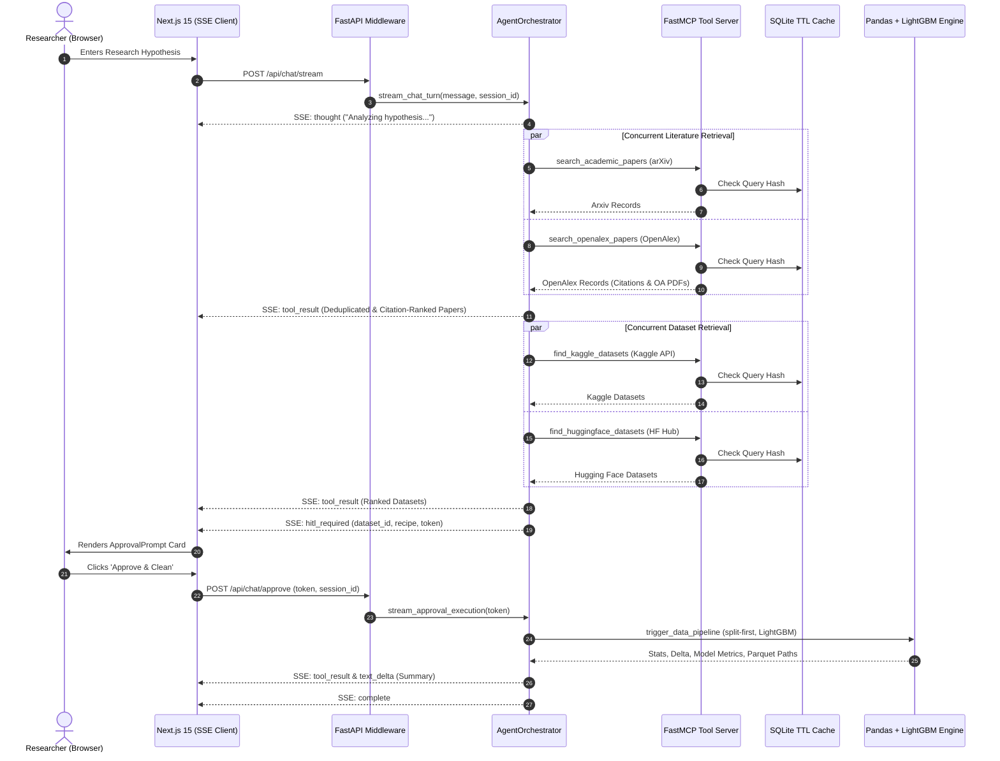

# Technical Requirements Document (TRD) v3.0
**Project:** Autonomous ML Research Agent (AMRA)  
**Version:** 3.0.0  
**Phase:** Multi-Source Enterprise Architecture & Benchmark Specifications  
**Author:** AI Systems Architecture & Engineering  
**Status:** Approved / Production-Certified  

---

## 1. System Architecture & Communication Topology

AMRA employs a decoupled, asynchronous 3-tier architecture separating client presentation, agent orchestration, and tool execution using the **Model Context Protocol (MCP)**.



---

## 2. FastMCP Tool Interface Specifications

### 2.1 Literature Discovery Tools
1. **`search_academic_papers`:**
   - **Signature:** `(query: str, max_results: int = 5, sort_by: str = "relevance", use_cache: bool = True) -> str`
   - **Upstream:** `http://export.arxiv.org/api/query` + `arxiv` Python SDK.
   - **Output Contract:** JSON list of `{ id, title, authors, published, summary, pdf_url, categories, source: "arXiv" }`.
   - **SLA:** Cold fetch $< 2.0\text{ s}$; Cached hit $< 0.15\text{ ms}$.

2. **`search_openalex_papers`:**
   - **Signature:** `(query: str, max_results: int = 5, sort_by: str = "relevance", use_cache: bool = True) -> str`
   - **Upstream:** `https://api.openalex.org/works` (filtered by `has_oa_accepted_or_published_version:true`).
   - **Output Contract:** JSON list of `{ id, title, authors, published, summary, pdf_url, doi, citation_count, categories, source: "OpenAlex" }`.
   - **SLA:** Cold fetch $< 1.5\text{ s}$; Cached hit $< 0.10\text{ ms}$.

### 2.2 Dataset Discovery Tools
1. **`find_kaggle_datasets`:**
   - **Signature:** `(query: str, max_results: int = 5, min_usability_score: float = 0.70, max_size_mb: int = 250, use_cache: bool = True) -> str`
   - **Upstream:** `kaggle.api.dataset_list` with automated fallback to `BENCHMARK_CATALOG`.
   - **Output Contract:** JSON list of `{ dataset_id, title, size_mb, usability_score, url, download_count, tags, source: "Kaggle", is_mock_demo }`.

2. **`find_huggingface_datasets`:**
   - **Signature:** `(query: str, max_results: int = 5, use_cache: bool = True) -> str`
   - **Upstream:** `https://huggingface.co/api/datasets`.
   - **Output Contract:** JSON list of `{ dataset_id, title, size_mb, usability_score, url, download_count, likes, tags, source: "Hugging Face", is_mock_demo }`.

---

## 3. Tabular Data Pipeline & Machine Learning Engine v3.0

### 3.1 Split-First Partitioning (Zero Data Leakage)
1. Ingest raw CSV via Pandas/PyArrow.
2. Normalize headers to lowercase `snake_case`.
3. Detect target column via heuristics (`fraud`, `churn`, `label`, `target`, `is_`, `class`).
4. Execute an 80/20 train/test partition using stratified sampling for classification or random sampling for regression.
5. All subsequent transformations (imputation medians, IQR fences, encoding maps) are fitted **strictly on the training set** and applied to both train and test sets.

### 3.2 Cleaning & Transformation Sequence
- **Duplicate Removal:** Identifies and drops exact duplicate rows.
- **Continuous Imputation:** Missing continuous values are imputed using the training feature median.
- **Categorical Imputation:** Missing categorical values are imputed using the training feature mode.
- **Outlier Winsorization:** Extreme numerical outliers beyond $[Q_1 - 1.5\text{IQR}, Q_3 + 1.5\text{IQR}]$ are winsorized to the boundary values.

### 3.3 Automated LightGBM Baseline Benchmarking
- If target column exists:
  - Ordinal encodes categorical features.
  - Trains a high-speed LightGBM classifier or regressor (100 estimators, early stopping).
  - Evaluates on the held-out 20% test fold.
  - Reports Accuracy, ROC-AUC, or RMSE.

### 3.4 Apache Parquet Storage
- Exports full cleaned dataset, training fold, and testing fold into high-compression Apache Parquet (`.parquet`) using PyArrow and Snappy compression alongside cleaned CSV.

---

## 4. Server-Sent Events (SSE) Protocol

| Event Type | Emitted By | Payload Contract |
| :--- | :--- | :--- |
| `thought` | AgentOrchestrator | `{ "type": "thought", "content": "..." }` |
| `tool_start` | AgentOrchestrator | `{ "type": "tool_start", "tool": "...", "args": { ... } }` |
| `tool_result` | AgentOrchestrator | `{ "type": "tool_result", "tool": "...", "result": [ ... ] }` |
| `hitl_required` | AgentOrchestrator | `{ "type": "hitl_required", "dataset_id": "...", "cleaning_recipe": { ... }, "approval_token": "..." }` |
| `text_delta` | AgentOrchestrator | `{ "type": "text_delta", "content": "..." }` |
| `cost_audit` | AgentOrchestrator | `{ "type": "cost_audit", "provider": "...", "prompt_tokens": int, "completion_tokens": int, "cost_usd": 0.00 }` |
| `complete` | AgentOrchestrator | `{ "type": "complete", "session_id": "..." }` |
| `error` | AgentOrchestrator | `{ "type": "error", "error_message": "..." }` |

---

## 5. Security & Path Boundary Specifications

1. **Path Traversal Protection:**
   - All input paths must match regex `^[a-zA-Z0-9_\-\.\/]+$`.
   - Resolved using `Path(target_dir).resolve()`. Target must resolve strictly within `PROJECT_ROOT / "data"` or `PROJECT_ROOT / "processed_data"`. Attempts to escape via `../` raise `ValueError` or HTTP 403.
2. **Replay Attack Protection:**
   - Single-use approval tokens generated via `secrets.token_hex(8)`.
   - Stored in volatile server memory `PENDING_APPROVALS: Dict[str, Dict[str, Any]]`.
   - Tokens are popped immediately upon validation; second usage attempts raise HTTP 400.

---

## 6. Neo-Brutalist UI/UX Technical Specifications (Phase 3)

The presentation tier adheres to a strict Neo-Brutalist architecture implemented in Next.js 15:

1. **Design Tokens & Palette:**
   - Literature Card: `--brut-yellow` (`#FFFF00`) with 4px black border and `6px 6px 0 #000000` hard shadow.
   - Dataset Card: `--brut-green` (`#00FF00`) with 4px black border and `6px 6px 0 #000000` hard shadow.
   - HITL Gate: `--brut-red` (`#FF0000`) with 4px black border and `8px 8px 0 #000000` hard shadow.
   - Peer Reviewed Badge: `--brut-cyan` (`#00FFFF`).
   - Benchmark Fallback Badge: `--brut-magenta` (`#FF00FF`).
   - Primary Buttons: `--brut-blue` (`#0000FF`) with white text and active translation (`translate(3px, 3px)`).
2. **Stream Consumer (`lib/sse-client.ts`):**
   - Implements chunked line-buffered decoding for `data: {...}` payloads.
   - Dispatches callbacks for `onThought`, `onToolStart`, `onToolResult`, `onHITLRequired`, `onTextDelta`, `onCostAudit`, `onComplete`, and `onError`.
3. **Interactive Components:**
   - `PaperCard.tsx`: arXiv + OpenAlex with citations count badge, canonical PDF link, and DOI button.
   - `DatasetCard.tsx`: Kaggle + Hugging Face with download metrics, likes counter, and modality tags.
   - `ApprovalPrompt.tsx`: Interactive confirmation gating local script execution.
   - `DataPreviewTable.tsx`: Tabular preview with health gauge, LightGBM baseline metrics tab, and CSV + Parquet download actions.

---

## 7. DevSecOps, Containerization & CI/CD Strategy (Phase 4)

1. **Multi-Service Docker Architecture:**
   - `Dockerfile.backend`: Python 3.11-slim container exposing FastAPI ASGI on port 8000.
   - `Dockerfile.frontend`: Node.js 20-alpine multi-stage build running Next.js on port 3000.
   - `docker-compose.yml`: Binds backend and frontend with localized volume mounts (`./data:/app/data`, `./processed_data:/app/processed_data`).
2. **Automated CI Regression Pipeline (`.github/workflows/ci.yml`):**
   - Enforces automated quality gates on every push/PR:
     ```powershell
     python tests/test_multi_source.py
     python tests/test_phase1_production.py
     python tests/test_phase2_backend.py
     ```
3. **Offline & Air-Gapped Mode:**
   - Setting `MODEL_PROVIDER=ollama` enables zero-internet local operation using Ollama (`qwen2.5:14b` or `llama3.1:8b`) with pre-cached datasets and benchmark fallbacks.

---

## 8. Four-Phase Technical Implementation Plan & Benchmark Matrix

| Phase | Milestone & Focus | Key Deliverables | Benchmark Exit Gates |
| :--- | :--- | :--- | :--- |
| **Phase 1** | **MCP Execution Layer & Standalone Tools** | `ml_research_server.py`, `arxiv_tool.py`, `openalex_tool.py`, `kaggle_tool.py`, `hf_dataset_tool.py`, `clean_data.py`, `cache.py` | • BR-01 Schema Contracts (100% Pydantic)<br>• BR-03 Zero Link Hallucinations<br>• BR-04 Latency SLA ($< 15\text{ ms}$ cache hit)<br>• BR-06 Data Health Score bounds |
| **Phase 2** | **Agent Middleware & Streaming Engine** | `backend/app/agent/factory.py`, `orchestrator.py`, `memory.py`, `routers/chat.py`, `routers/data.py` | • BR-02 Edge Resilience & Replay Protection<br>• BR-05 Path Isolation ($0$ escapes)<br>• SSE 10-event streaming lifecycle<br>• Zero-cost model audit |
| **Phase 3** | **Conversational UI & Neo-Brutalist Cards** | `frontend/components/PaperCard.tsx`, `DatasetCard.tsx`, `ApprovalPrompt.tsx`, `DataPreviewTable.tsx`, `ChatInterface.tsx`, `sse-client.ts` | • Next.js 15 production build passes (`npm run build`)<br>• 0 TypeScript / 0 Lint errors<br>• Neo-Brutalism tokens ($4\text{px}$ borders, shadows)<br>• Citations, likes, DOIs, LightGBM metrics rendered |
| **Phase 4** | **DevSecOps, Sandboxing & Portfolio Polish** | `docker-compose.yml`, `Dockerfile.backend`, `Dockerfile.frontend`, `.github/workflows/ci.yml`, `README.md` | • Multi-container build passes<br>• CI regression pipeline passing (100%)<br>• Offline Ollama mode verified<br>• Copy-paste resume bullet points documented |
| **Phase 5** | **Multi-Tenant Authentication & Relational DB** | `backend/app/auth.py`, `backend/app/db/database.py`, `backend/app/routers/auth.py`, `frontend/app/login/page.tsx` | • NIST PBKDF2 (100,000 iterations)<br>• PyJWT 7-day signed access tokens<br>• Google, GitHub, Outlook OAuth 2.0<br>• Multi-tenant thread isolation by `user_id`<br>• `test_auth_database.py` 100% passing |
| **Phase 6** | **Cloudflare Pages & 3-Tier Edge Caching** | `public/_headers`, `public/_routes.json`, `wrangler.toml`, `backend/app/cache.py`, `routers/cache.py`, `frontend/app/cloudflare/page.tsx` | • Cloudflare Pages Edge CDN (330+ PoPs)<br>• In-memory RAM cache ($> 23,000\text{ RPS}$, $< 0.01\text{ ms}$)<br>• Interactive 50-req load burst simulator<br>• `test_cloudflare_caching.py` 100% passing |

