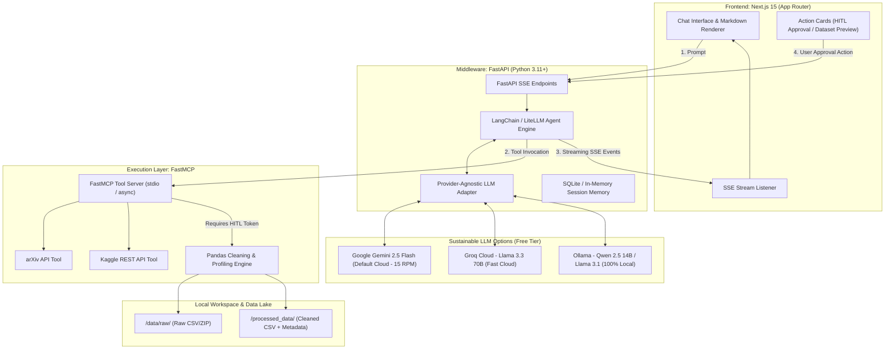

# Technical Requirements Document (TRD) v2.0
**Project:** Autonomous ML Research Agent (AMRA)  
**Version:** 2.0.0  
**Frameworks:** Next.js 15 (App Router), FastAPI, FastMCP, LangChain / LiteLLM  
**Recommended Free & Sustainable Models:** Google Gemini 2.5 Flash (Cloud Primary) / Groq Llama 3.3 70B (High-Speed Cloud) / Ollama Qwen 2.5 14B (Local Offline)  
**Status:** Approved Architecture  

---

## 1. System Architecture & Flow

The system employs a decoupled, asynchronous, 3-tier architecture with real-time Server-Sent Events (SSE) streaming and Human-in-the-Loop (HITL) gatekeeping.



---

## 2. Recommended Model Selection & Sustainability Analysis

The previous v1.0 specification relied on **Claude 3.5 Sonnet**, which requires a paid Anthropic API account with recurring per-token charges and tight rate-limit tiers for unverified accounts. 

To ensure **zero operating cost, long-term sustainability, and production-grade tool calling**, the architecture introduces a **Provider-Agnostic Model Interface** supporting three top-tier alternatives:

### Detailed Model Evaluation Matrix

| Criterion | 1. Google Gemini 2.5 Flash *(Recommended Cloud)* | 2. Groq Cloud (Llama 3.3 70B) *(Speed Champion)* | 3. Local Ollama (Qwen 2.5 14B/32B) *(100% Private & Free)* | Previous: Claude 3.5 Sonnet |
| :--- | :--- | :--- | :--- | :--- |
| **Cost** | **$0.00** (Free Tier via Google AI Studio) | **$0.00** (Free Developer Tier) | **$0.00** (Open Source, runs on local GPU/CPU) | Paid (~$3.00 / $15.00 per MTok) |
| **Sustainability** | High (15 RPM, 1M TPM, 1,500 requests/day free quota) | High (Generous free tier with rolling limits) | **Infinite** (Never expires, no API keys, zero network dependence) | Low (Depletes developer credits rapidly) |
| **Context Window** | **1,000,000+ tokens** (Can ingest entire research papers) | 128,000 tokens | 32,000 – 128,000 tokens (hardware dependent) | 200,000 tokens |
| **Tool Calling Reliability** | **Exceptional** (Native schema validation) | **Very High** (Fine-tuned for function calling) | **High** (Qwen 2.5 achieves 90%+ BFCL score) | Exceptional |
| **Generation Speed** | ~100–150 tokens/sec | **280–350 tokens/sec** (Near-instant) | 35–70 tokens/sec (on RTX 3060/4060 or M-series) | ~60–80 tokens/sec |
| **Hardware Required** | None (Cloud API) | None (Cloud API) | Modern 8GB–16GB VRAM or Apple Silicon | None (Cloud API) |
| **Privacy / Offline** | Cloud | Cloud | **100% Air-gapped / Local** | Cloud |

### Recommended Deployment Configuration:
1. **Primary Cloud Default:** **Google Gemini 2.5 Flash** (or 2.0 Flash) via `langchain-google-genai`. It offers a 1M context window (ideal for summarizing long research abstracts and dataset schemas) and a robust free tier of 1,500 requests per day.
2. **Speed Cloud Alternative:** **Groq Cloud (`llama-3.3-70b-versatile`)** via `langchain-groq`. Ultra-fast inference with sub-second tool routing.
3. **Local Self-Hosted Alternative:** **Ollama with `qwen2.5:14b-instruct`** or `llama3.1:8b` via `langchain-ollama`. Enables 100% free, sustainable, air-gapped data science with zero reliance on external API uptime.

---

## 3. Technology Stack & Dependencies

### Frontend Layer
- **Framework:** Next.js 15 (React 19, App Router)
- **Styling & Components:** Tailwind CSS v3/v4, shadcn/ui primitives, Lucide React icons
- **State & Streaming:** Native `fetch` with `ReadableStream` reader (SSE parser), Zustand for session state

### Backend Host (Middleware)
- **Runtime:** Python 3.11+
- **Framework:** FastAPI, Uvicorn (ASGI)
- **Agent Orchestrator:** LangChain (`langchain`, `langchain-core`) or LiteLLM
- **Model Providers:**
  - `langchain-google-genai` (for Gemini Flash)
  - `langchain-groq` (for Groq Llama 3.3)
  - `langchain-ollama` (for local Ollama)
- **Validation:** Pydantic v2

### Execution Layer (MCP Server)
- **Protocol:** FastMCP (`fastmcp >= 0.4.0`)
- **Academic API:** `arxiv` (Python wrapper for arXiv API)
- **Dataset API:** `kaggle` (Official Kaggle CLI/SDK)
- **Data Engineering:** `pandas`, `numpy`

---

## 4. FastMCP Tool Manifest & Contracts

The FastMCP server (`mcp_server/ml_research_server.py`) exposes strictly typed tools adhering to JSON Schema specifications.

### Tool 1: `search_academic_papers`
* **Purpose:** Queries arXiv API for literature matching the research topic.
* **Input Schema:**
  ```python
  class ArxivSearchInput(BaseModel):
      query: str = Field(description="Search terms or algorithm names (e.g., 'graph neural networks fraud detection')")
      max_results: int = Field(default=5, ge=1, le=10, description="Number of papers to retrieve")
      sort_by: Literal["relevance", "lastUpdatedDate", "submittedDate"] = Field(default="relevance")
  ```
* **Output:** JSON array containing objects with:
  - `id`: arXiv ID (e.g., `"2401.12345"`)
  - `title`: Paper title
  - `authors`: List of author names
  - `published`: ISO date
  - `summary`: Cleaned abstract (max 500 characters)
  - `pdf_url`: Direct link to PDF (`https://arxiv.org/pdf/...`)

### Tool 2: `find_kaggle_datasets`
* **Purpose:** Searches Kaggle for public tabular datasets matching the research topic.
* **Input Schema:**
  ```python
  class KaggleSearchInput(BaseModel):
      query: str = Field(description="Keywords for datasets (e.g., 'credit card fraud detection csv')")
      max_results: int = Field(default=5, ge=1, le=10)
      max_size_mb: int = Field(default=250, description="Max allowed dataset download size in MB")
  ```
* **Output:** JSON array with:
  - `dataset_id`: Official ref (e.g., `"mlg-ulb/creditcardfraud"`)
  - `title`: Dataset title
  - `size_mb`: Dataset size in megabytes
  - `usability_score`: Float between 0.0 and 1.0
  - `url`: Official Kaggle URL

### Tool 3: `inspect_dataset_metadata`
* **Purpose:** Inspects files inside a Kaggle dataset without full local processing.
* **Input Schema:**
  ```python
  class InspectDatasetInput(BaseModel):
      dataset_id: str = Field(pattern=r"^[a-zA-Z0-9_-]+/[a-zA-Z0-9_.-]+$")
  ```
* **Output:** List of filenames, file formats (CSV, JSON, Parquet), and estimated row counts.

### Tool 4: `trigger_data_pipeline` (HITL Gated)
* **Purpose:** Downloads, unzips, cleans, and profiles tabular datasets locally.
* **Security Guard:** Requires an explicit `approval_token` generated by the backend and confirmed by the user.
* **Input Schema:**
  ```python
  class TriggerPipelineInput(BaseModel):
      dataset_id: str = Field(pattern=r"^[a-zA-Z0-9_-]+/[a-zA-Z0-9_.-]+$")
      approval_token: str = Field(description="Verification token issued upon user confirmation")
      handle_missing: Literal["drop", "median_impute", "mean_impute", "mode_impute"] = Field(default="median_impute")
      drop_duplicates: bool = Field(default=True)
      normalize_headers: bool = Field(default=True, description="Converts headers to snake_case")
  ```
* **Output:** JSON containing:
  - `status`: `"success"` | `"failed"`
  - `output_filepath`: Path to saved CSV in `/processed_data/`
  - `stats_before`: `{ "rows": 10000, "cols": 30, "null_count": 420 }`
  - `stats_after`: `{ "rows": 9950, "cols": 30, "null_count": 0 }`
  - `head_preview`: Top 5 rows as JSON objects

---

## 5. Security & Isolation Protocol

1. **Subprocess & Sanitization Guardrails:**
   - Dataset IDs are strictly validated with Regex: `^[a-zA-Z0-9_-]+/[a-zA-Z0-9_.-]+$`. No spaces, shell meta-characters (`;`, `&`, `|`, `` ` ``), or relative path sequences (`../`) are permitted.
   - Subprocesses are spawned with fixed argument lists (`subprocess.run(["python", ...])`), completely bypassing `shell=True`.
   - Execution watchdog: hard timeout limit of 60 seconds per data cleaning run to prevent infinite loops.
2. **File System Sandboxing:**
   - Raw downloads are constrained to `workspace/data/raw/<sanitized_id>/`.
   - Processed exports are constrained to `workspace/processed_data/`.
   - Disk quota cap: Any dataset download exceeding 250MB is halted before extraction.
3. **Secret Isolation:**
   - `kaggle.json` / `KAGGLE_USERNAME` & `KAGGLE_KEY` are read exclusively by the backend service.
   - LLM API keys (`GEMINI_API_KEY` / `GROQ_API_KEY`) are held in memory on the backend and never passed to the frontend.

---

## 6. Real-Time Streaming & Communication Protocol

The FastAPI server provides a Server-Sent Events endpoint: `POST /api/chat/stream`.

### Event Stream Envelope
```json
// Event: status
data: {"type": "thought", "content": "Analyzing query and querying arXiv for recent transformer papers..."}

// Event: tool_start
data: {"type": "tool_start", "tool": "search_academic_papers", "args": {"query": "transformer time series"}}

// Event: tool_result
data: {"type": "tool_result", "tool": "search_academic_papers", "result": [{"title": "...", "pdf_url": "..."}]}

// Event: hitl_required
data: {"type": "hitl_required", "action": "download_and_clean", "dataset_id": "author/dataset", "token": "sec_tok_99182"}

// Event: message_delta
data: {"type": "text_delta", "content": "I have found 5 papers and a matching Kaggle dataset. Would you like me to clean it?"}
```

---

## 7. Directory Architecture

```
ml-research-platform/
├── .env.example                       # Provider keys & Kaggle credentials
├── README.md                          # Quickstart guide
├── docker-compose.yml                 # Optional local containerization
│
├── frontend/                          # Next.js 15 App
│   ├── app/
│   │   ├── layout.tsx                 # Root layout with fonts & theme
│   │   ├── page.tsx                   # Main conversational research workspace
│   │   └── api/                       # Optional Next API proxy
│   ├── components/
│   │   ├── ChatInterface.tsx          # Multi-turn chat with auto-scroll
│   │   ├── MessageBubble.tsx          # Markdown + Syntax highlighting
│   │   ├── PaperCard.tsx              # arXiv paper preview with direct PDF links
│   │   ├── DatasetCard.tsx            # Kaggle metadata card with usability score
│   │   ├── ApprovalPrompt.tsx         # HITL confirmation dialogue button
│   │   └── DataPreviewTable.tsx       # Tabular view of cleaned CSV preview
│   ├── lib/
│   │   └── sse-client.ts              # Robust SSE stream consumer
│   ├── package.json
│   └── tailwind.config.ts
│
├── backend/                           # FastAPI Middleware
│   ├── app/
│   │   ├── __init__.py
│   │   ├── main.py                    # FastAPI entrypoint & CORS config
│   │   ├── config.py                  # Pydantic Settings (.env loader)
│   │   ├── agent/
│   │   │   ├── factory.py             # Model switch (Gemini / Groq / Ollama)
│   │   │   ├── orchestrator.py        # LangChain agent loop & SSE emitter
│   │   │   └── memory.py              # SQLite session conversation memory
│   │   ├── routers/
│   │   │   ├── chat.py                # SSE streaming endpoints
│   │   │   └── data.py                # Endpoints to download/view cleaned CSVs
│   │   └── schemas/
│   │       └── events.py              # Pydantic schemas for SSE events
│   └── requirements.txt
│
├── mcp_server/                        # FastMCP Execution Layer
│   ├── ml_research_server.py          # FastMCP server exposing arXiv & Kaggle tools
│   ├── tools/
│   │   ├── arxiv_tool.py              # arXiv querying & formatting logic
│   │   ├── kaggle_tool.py             # Kaggle dataset search & inspection
│   │   └── pipeline_runner.py         # Subprocess runner for Pandas script
│   ├── pipeline/
│   │   └── clean_data.py              # Standalone Pandas cleaning script
│   └── requirements.txt
│
├── data/
│   └── raw/                           # Downloaded raw archives (gitignored)
└── processed_data/                    # Cleaned CSV outputs & profiles (gitignored)
```

---

## 8. Environment Configuration (`.env.example`)

```bash
# Model Selection: "gemini" | "groq" | "ollama"
MODEL_PROVIDER=gemini

# Google Gemini (Free tier from Google AI Studio: https://aistudio.google.com/)
GEMINI_API_KEY=your_gemini_api_key_here
GEMINI_MODEL=gemini-2.5-flash

# Groq Cloud (Free tier from Groq Console: https://console.groq.com/)
GROQ_API_KEY=your_groq_api_key_here
GROQ_MODEL=llama-3.3-70b-versatile

# Ollama Local (If MODEL_PROVIDER=ollama)
OLLAMA_BASE_URL=http://localhost:11434
OLLAMA_MODEL=qwen2.5:14b

# Kaggle API Credentials (https://www.kaggle.com/settings -> Create New Token)
KAGGLE_USERNAME=your_kaggle_username
KAGGLE_KEY=your_kaggle_key

# FastMCP Server
MCP_SERVER_PATH=../mcp_server/ml_research_server.py
MAX_DATASET_DOWNLOAD_MB=250
```

---

## 9. Four-Phase Technical Implementation Plan

| Phase | Core Objective | Primary Components | Key Tests & Verification |
| :--- | :--- | :--- | :--- |
| **Phase 1: Core MCP Execution Layer** | Build tool definitions, third-party integrations & isolated cleaning scripts | `mcp_server/ml_research_server.py`, `arxiv_tool.py`, `kaggle_tool.py`, `pipeline/clean_data.py` | Verify tools return strict JSON; test Kaggle download + Pandas cleaning with mock & real datasets via FastMCP CLI |
| **Phase 2: Agent Orchestration & SSE Middleware** | Implement provider factory, agent reasoning loop, and streaming endpoints | `backend/app/agent/factory.py`, `orchestrator.py`, `routers/chat.py`, `memory.py` | Test SSE stream via curl; verify model switching (`gemini`, `groq`, `ollama`); confirm HITL token pause/resume |
| **Phase 3: Conversational Web Interface** | Build responsive Next.js UI, custom SSE client, and interactive action cards | `frontend/app/page.tsx`, `sse-client.ts`, `PaperCard.tsx`, `ApprovalPrompt.tsx`, `DataPreviewTable.tsx` | End-to-end user testing: query submission -> streaming thoughts -> HITL card approval -> preview table display |
| **Phase 4: Production Hardening & Sandbox Security** | Add timeouts, input sanitization, Docker orchestration, and offline testing | `docker-compose.yml`, execution timeout watchdogs, Ollama offline verification, unit/integration suites | Path traversal fuzzing, offline mode with Ollama without internet, Docker Compose one-command launch test |

