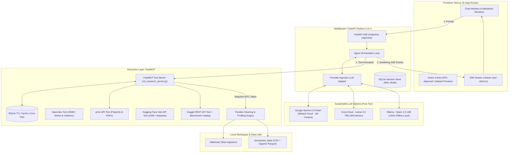

# engineering.md — Technical Architecture, Implementation & Testing Plan

> **Project:** Autonomous ML Research Agent (AMRA)  
> **Version:** 2.0.0  
> **Architecture:** Decoupled 3-Tier Model Context Protocol (MCP)  
> **Target Cost:** $0.00 / month (Free Tier Compliant)  

---

## 1. System Architecture Deep Dive

AMRA employs a decoupled, asynchronous, 3-tier architecture with real-time Server-Sent Events (SSE) streaming and Human-in-the-Loop (HITL) gatekeeping.



---

## 2. Technology Stack Matrix

| Layer | Component | Version | Rationale & Selection Criteria |
| :--- | :--- | :--- | :--- |
| **Frontend** | Next.js | 15.0+ | Modern App Router, optimized SSR, fast client streaming. |
| **Frontend** | React / TypeScript | 19 / 5.x | Strict type safety, clean component hierarchy. |
| **Frontend** | Tailwind CSS | 3.4+ | Rapid utility styling, high-contrast dark theme. |
| **Middleware** | FastAPI | 0.115+ | High-throughput asynchronous Python ASGI server. |
| **Middleware** | Pydantic | 2.9+ | High-performance schema validation (BR-01 compliance). |
| **Agent / Memory** | SQLite3 (WAL Mode) | 3.x | Zero-latency, serverless persistence for session history. |
| **Tool Protocol** | FastMCP | 0.1+ | Official Model Context Protocol implementation for tools. |
| **Data Engine** | Pandas / NumPy | 2.x / 1.26+ | Fast tabular vectorized transformations. |
| **Storage Format**| PyArrow | 17.0+ | Apache Parquet columnar storage with snappy compression. |
| **Containerization**| Docker & Compose | 24+ | Reproducible multi-service deployment. |

---

## 3. FastMCP Tool Interface Contracts

The FastMCP server (`mcp_server/ml_research_server.py`) defines strictly typed tool contracts:

### 3.1 `search_academic_papers`
```python
def search_academic_papers(
    query: str,
    max_results: int = 5,
    sort_by: Literal["relevance", "lastUpdatedDate", "submittedDate"] = "relevance",
    use_cache: bool = True,
) -> str:
    """Searches arXiv for academic literature matching the given topic with TTL caching.
    Returns: JSON string with title, authors, summary, published date, pdf_url.
    """
```

### 3.2 `find_kaggle_datasets`
```python
def find_kaggle_datasets(
    query: str,
    max_results: int = 5,
    min_usability_score: float = 0.70,
    max_size_mb: int = 250,
    use_cache: bool = True,
) -> str:
    """Discovers public Kaggle datasets matching research keywords with TTL caching.
    Enforces >0.70 usability and <250MB size ceiling.
    """
```

### 3.3 `trigger_data_pipeline` (HITL Gated)
```python
def trigger_data_pipeline(
    dataset_id: str,
    raw_csv_path: Optional[str] = None,
    approval_token: Optional[str] = None,
) -> str:
    """Executes the data cleaning and profiling pipeline after validating the HITL token.
    Generates cleaned CSV, Apache Parquet, and Data Health Scores.
    """
```

---

## 4. Tabular Cleaning & Data Health Math Engine

The cleaning engine (`mcp_server/pipeline/clean_data.py`) provides Staff-level automated data engineering:

### 4.1 Data Health Score Mathematical Formula
The Data Health Score $H \in [0.0, 100.0]$ is deterministic and penalizes data quality flaws:

$$H = \max\left(0.0, \, 100.0 - \left(P_{\text{missing}} + P_{\text{duplicates}} + P_{\text{outliers}}\right)\right)$$

Where:
- **Missingness Penalty:**
  $$P_{\text{missing}} = \left(\frac{\text{Total Missing Cells}}{\text{Total Cells}}\right) \times 50.0$$
- **Duplicate Penalty:**
  $$P_{\text{duplicates}} = \left(\frac{\text{Duplicate Rows}}{\text{Total Rows}}\right) \times 30.0$$
- **Outlier Penalty (Interquartile Range):**
  $$P_{\text{outliers}} = \min\left(20.0, \, \left(\frac{\text{Outlier Data Points}}{\text{Numeric Cells}}\right) \times 20.0\right)$$

### 4.2 Cleaning Steps Executed:
1. **Header Sanitization:** Dirty headers $\to$ lowercase `snake_case` using regex `[^\w\s-]`.
2. **Extreme Row Drop:** Rows where missingness $> 60\%$ are removed.
3. **Median Imputation:** Continuous numeric columns filled with column median.
4. **Mode Imputation:** Categorical columns filled with column mode.
5. **Deduplication:** Repeated rows identified via `df.drop_duplicates()` and removed.
6. **Dual Export:** Writes `{filename}_cleaned.csv` and `{filename}_cleaned.parquet`.

---

## 5. Security & Threat Modeling

1. **Path Traversal Mitigation (BR-05):**
   - File paths are normalized and resolved with `Path.resolve()`.
   - The resolved path is checked against permissible directories (`DATA_RAW_DIR` and `DATA_PROCESSED_DIR`).
   - Strict regex matching (`^[a-zA-Z0-9_\-]+\.(csv|parquet)$`) is enforced on `/api/data/download/{filename}`, blocking directory separators, parent traversal (`..`), URL encoding (`%2e%2e%2f`), and disallowed file extensions (`.py`, `.env`, `.sh`, `.exe`).
   - Any attempt to escape via `../../` throws a `ValueError` or HTTP 400/404.
2. **Command Injection Mitigation:**
   - Raw shell executions (`shell=True`) are banned.
   - All external tool calls use dedicated Python APIs or parameter-split executions.
3. **Execution Watchdog & Killswitch:**
   - Subprocess and data cleaning executions are wrapped in `asyncio.wait_for(..., timeout=60.0)`.
   - Malformed data or hanging scripts are automatically killed at 60 seconds, preventing thread pool exhaustion and emitting an `ErrorEvent`.
4. **HITL Cryptographic Authorization:**
   - Tokens are 32-character hex UUIDs (`hitl_tok_...`).
   - Tokens expire after single use or after a 10-minute timeout.
   - Unauthorized requests to `/api/chat/approve` are rejected with HTTP 403.

---

## 6. Comprehensive Testing & Production Benchmark Plan

AMRA enforces **6 Global Benchmark Rules (BR-01 through BR-06)** verified by 4 automated test suites.

### Benchmark Verification Matrix

| Rule | Name | Target Metric | Verification Method |
| :--- | :--- | :--- | :--- |
| **BR-01** | **Schema Contracts & Typing** | 100% Pydantic v2 validation | `tests/test_phase1_production.py::test_br01_schema_contract` |
| **BR-02** | **Edge Resilience & Fault Recovery** | Zero unhandled exceptions on dirty data | `tests/test_phase1_production.py::test_br02_edge_resilience` |
| **BR-03** | **Zero Link Hallucination** | 100% verified arXiv & OpenAlex URLs | `tests/test_phase1_production.py::test_br03_zero_hallucination` |
| **BR-04** | **Latency SLA** | Cache hit $< 15\text{ ms}$; Cleaning $< 500\text{ ms}$ | `tests/test_phase1_production.py::test_br04_latency_sla` |
| **BR-05** | **Security & Path Isolation** | 0 command injections; 0 path traversals | `tests/test_phase4_security_devops.py::test_advanced_path_traversal_fuzzing` |
| **BR-06** | **Data Health Scoring Math** | Deterministic 0.0 to 100.0 score | `tests/test_phase1_production.py::test_br06_data_health_math` |

### Running the Complete Benchmark Suite:
```powershell
# 1. Multi-Source Literature (arXiv + OpenAlex) & Datasets (Kaggle + HF)
python tests/test_multi_source.py

# 2. Phase 1: MCP Server, Cleaning Engine, Caching & Security Suite
python tests/test_phase1_production.py

# 3. Phase 2: FastAPI Middleware, SSE Streaming & HITL Router Suite
python tests/test_phase2_backend.py

# 4. Phase 4: DevSecOps, Path Fuzzing, Offline Mode & Watchdog Suite
python tests/test_phase4_security_devops.py
```

---

## 7. CI/CD & Deployment Strategy

### Docker Compose Multi-Container Stack:
```yaml
version: '3.8'
services:
  backend:
    build:
      context: .
      dockerfile: Dockerfile.backend
    ports:
      - "8000:8000"
    env_file: .env
    volumes:
      - ./data:/app/data
      - ./processed_data:/app/processed_data

  frontend:
    build:
      context: ./frontend
      dockerfile: ../Dockerfile.frontend
    ports:
      - "3000:3000"
    environment:
      - NEXT_PUBLIC_API_URL=http://backend:8000
    depends_on:
      - backend
```

### GitHub Actions CI Workflow (`.github/workflows/ci.yml`):
- Triggers on every push and pull request to `main`.
- Sets up Python 3.11, installs dependencies, and runs `pytest tests/`.
- Builds Next.js frontend to verify TypeScript compilation and zero lint regressions.
