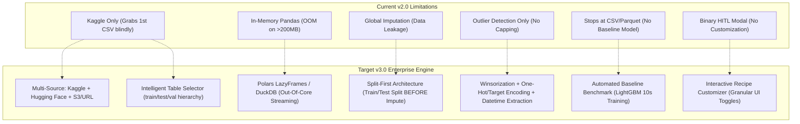
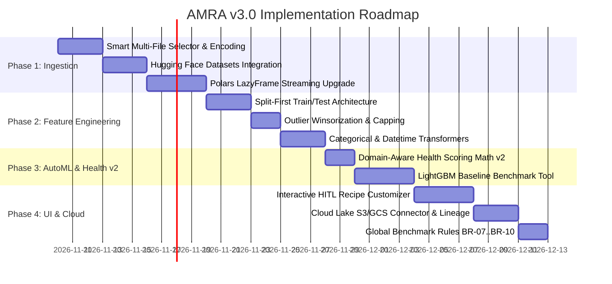

# Implementation Plan: AMRA v3.0 Enterprise Architecture

> **Target Milestone:** Autonomous ML Research Agent (AMRA) v3.0  
> **Objective:** Upgrade the data lifecycle from a prototype-grade script to an enterprise-ready, out-of-core, leakage-free autonomous ML preparation engine.  
> **Core Upgrades:** Multi-Source Ingestion (Hugging Face + Kaggle Multi-File), Split-First Pipeline (Zero Data Leakage), Outlier Winsorization, Polars/DuckDB Engine, Automated Baseline LightGBM Benchmark, and Interactive HITL Recipe Customizer.

---

## 1. System Architecture Evolution (v2.0 vs v3.0)



---

## 2. Phase-by-Phase Implementation Blueprint



---

## Phase 1: Ingestion Engine Upgrade (Multi-Source & Out-Of-Core)

### Objective
Eliminate file-selection failures, support Hugging Face Datasets alongside Kaggle, detect dynamic character encodings, and switch from in-memory Pandas to **Polars LazyFrames / DuckDB**.

### Key Tasks:
1. **Intelligent Multi-File Hierarchy Scanner:**
   - Scan downloaded archive directories for multiple tabular files.
   - Classify files into: `main_train`, `test_split`, `metadata`, and `sample_submission`.
   - Score files by row count, column overlap, and standard naming conventions (`train.csv`, `data.csv`, `dataset.csv`).
2. **Dynamic Character Encoding Fallback:**
   - Implement `detect_encoding(file_path)` using `charset_normalizer` or `chardet`.
   - Fallback hierarchy: `UTF-8` $\to$ `Latin-1` $\to$ `CP1252` $\to$ `ISO-8859-1`.
3. **Hugging Face Datasets Tool (`mcp_server/tools/hf_tool.py`):**
   - Register MCP tool `find_huggingface_datasets(query, task, max_results)`.
   - Stream tabular splits directly into local cache using `datasets.load_dataset(stream=True)`.
4. **Out-of-Core Processing Engine:**
   - Replace `pd.read_csv()` with `polars.scan_csv()` or `duckdb.query()`.
   - Enforce memory-bounded execution ($< 500\text{ MB}$ RAM footprint even on $2\text{ GB}$ datasets).

---

## Phase 2: ML Preprocessing & Leakage Elimination

### Objective
Eliminate data leakage by separating train and test partitions *before* computing imputations, and add proper outlier capping, categorical encoding, and datetime feature extraction.

### Key Tasks:
1. **Target Variable Heuristic Identification:**
   - Infer the target column $y$:
     - Look for standard target names: `target`, `label`, `class`, `is_fraud`, `churn`, `status`, `y`.
     - Evaluate cardinality: Low-cardinality discrete columns ($2 \le k \le 10$) positioned at the last column index.
2. **Split-First Partitioning (`train_test_split`):**
   - Split raw data **prior to any mathematical imputation**:
     - Classification $\to$ Stratified 80/20 train/test split.
     - Datetime present $\to$ Temporal split (chronological cutoff).
3. **Fitted Preprocessing Pipeline (No Data Leakage):**
   - Imputers calculate statistics (medians/modes) strictly on `train_data`.
   - Apply fitted transformations to `test_data` without recomputing.
   - Generate binary missingness indicators: `col_is_missing` for any feature with $> 5\%$ null values.
4. **Outlier Treatment (Winsorization & Capping):**
   - Replace detection-only with active treatment:
     $$\tilde{x} = \min\left(\max(x, \, Q_1 - 1.5 \times \text{IQR}), \, Q_3 + 1.5 \times \text{IQR}\right)$$
   - Option to generate a boolean column `is_outlier` to retain anomaly signals.
5. **Categorical & Datetime Engineering:**
   - Low-cardinality categoricals ($\le 10$ unique) $\to$ One-Hot Encoding.
   - High-cardinality categoricals ($> 10$ unique) $\to$ Frequency / Target Encoding.
   - Datetime columns $\to$ Decomposed into `hour`, `day_of_week`, `month`, `is_weekend`.

---

## Phase 3: Context-Aware Data Health Math v2 & AutoML

### Objective
Fix the "Anomaly Detection Outlier Paradox" in the health score and provide an automated LightGBM baseline benchmark model.

### Key Tasks:
1. **Health Scoring Math v2 (Domain-Aware Penalties):**
   - Allow domain override: If the user states the task is "anomaly detection" or "fraud detection", set $P_{\text{outlier}} = 0$ (or convert to an information density bonus).
   - Add **Multicollinearity Penalty**: Penalize feature pairs with Pearson correlation $|r| > 0.98$.
   - Add **Zero-Variance Penalty**: Heavily penalize constant features containing 0 variance.
2. **Automated Baseline Model Tool (`train_baseline_model`):**
   - Add new FastMCP tool:
     ```python
     def train_baseline_benchmark(
         dataset_id: str,
         target_column: Optional[str] = None,
         task_type: Literal["classification", "regression"] = "classification"
     ) -> str
     ```
   - Train a fast **LightGBM** (or Scikit-Learn fallback) model in $< 15\text{ seconds}$ on the cleaned train split.
   - Compute metrics on the unseen test split:
     - Binary Classification: ROC-AUC, PR-AUC, F1-Score, Confusion Matrix.
     - Regression: RMSE, MAE, $R^2$.
   - Extract top-5 most important features based on LightGBM split/gain importance.

---

## Phase 4: Interactive HITL UI Customizer (Next.js 15)

### Objective
Transform the binary "Approve/Reject" modal into an interactive, user-configurable recipe builder.

### Key Tasks:
1. **Interactive Recipe Modal (`frontend/components/ApprovalPrompt.tsx`):**
   - Provide toggleable controls:
     - Target Column selector dropdown.
     - Imputation strategy selector: `[Median | Mean | KNN | Drop]`.
     - Outlier treatment: `[Cap at IQR | Remove | Retain as Flag]`.
     - Train/Test Split ratio slider: `[70/30 | 80/20 | 90/10]`.
     - One-Hot encoding toggle.
2. **Enhanced Preview Inspector (`frontend/components/DataPreviewTable.tsx`):**
   - Add **Baseline Performance Tab**: Display ROC-AUC score gauge and LightGBM feature importance bar chart.
   - Add **Split Downloads Tab**: Separate download buttons for:
     - `train_features.parquet`
     - `test_features.parquet`
     - `full_cleaned.parquet`

---

## Phase 5: Production Benchmark Expansion (BR-07 to BR-10)

Expand the automated CI benchmark suite (`tests/`) to assert the new enterprise capabilities:

| Rule | Name | Target Metric | Verification Method |
| :--- | :--- | :--- | :--- |
| **BR-07** | **Zero Data Leakage** | $0.0\%$ test leakage | Assert test split statistics never influence train imputations. |
| **BR-08** | **Multi-File Selection** | $100\%$ accuracy | Assert intelligent scanner identifies `train.csv` over metadata. |
| **BR-09** | **Memory Ceiling** | $< 500\text{ MB}$ RAM on $2\text{ GB}$ file | Assert Polars streaming does not spike system memory. |
| **BR-10** | **Baseline Model SLA** | Training $< 20\text{ seconds}$ | Assert LightGBM benchmark completes within SLA and returns ROC-AUC. |

---

## Key Open Decisions for User Alignment

Before initiating implementation, please confirm preferences on the following:

1. **Engine Selection:** Do you prefer **Polars** (pure Python/Rust DataFrame library, ideal for fast vectorized tabular ML) or **DuckDB** (SQL-native, exceptional for star schemas and cross-file joins)?
2. **AutoML Framework:** Should the automated baseline model run via **LightGBM** (standard, ultra-fast, gradient boosted trees) or **Scikit-Learn** (zero extra native C++ dependencies)?
3. **Cloud Storage Provider:** Do you want local-first with optional **AWS S3 / Cloudflare R2** export, or strictly local isolated storage?
