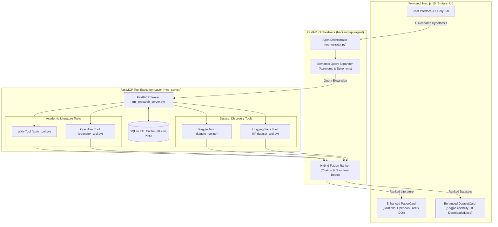

# Implementation Plan: Multi-Source Literature & Dataset Expansion

> **Project:** Autonomous ML Research Agent (AMRA)  
> **Milestone:** Multi-Source Research & High-Precision Data Aggregation  
> **Objective:** Expand AMRA from a single-source system (arXiv + Kaggle) into a multi-source hybrid search engine by integrating **OpenAlex API** (250M+ peer-reviewed works with citation ranking and verified OA PDFs) and **Hugging Face Hub API** (150K+ modern ML datasets with download metrics and parquet streaming).

---

## 1. Architecture Overview

---

## 2. Work Breakdown Structure (WBS)

### Phase 1: OpenAlex Academic Literature Tool (`mcp_server/tools/openalex_tool.py`)
- **API Endpoint:** `https://api.openalex.org/works`
- **Capabilities:**
  - Full-text search across 250M+ peer-reviewed scholarly works.
  - Mandatory Open-Access filter: `filter=has_oa_accepted_or_published_version:true`.
  - Extracts canonical PDF URLs (`open_access.oa_url`), DOIs (`doi`), publication years, and total citation counts (`cited_by_count`).
  - Thread-safe SQLite TTL caching (`QueryCache`) with MD5 query hashing.
  - Sorting: Options for `relevance` or `cited_by_count:desc`.

### Phase 2: Hugging Face Datasets Tool (`mcp_server/tools/hf_dataset_tool.py`)
- **API Endpoint:** `https://huggingface.co/api/datasets`
- **Capabilities:**
  - Queries 150,000+ public machine learning datasets.
  - Extracts dataset slug/ID, description, download counts, likes, author, and direct dataset viewer links (`https://huggingface.co/datasets/{id}`).
  - Identifies tabular and parquet file formats.
  - Filters out deprecated/empty datasets.
  - Thread-safe SQLite TTL caching (`QueryCache`).

### Phase 3: FastMCP Tool Server Registration (`mcp_server/ml_research_server.py`)
- Expose and decorate two new FastMCP tools:
  - `search_openalex_papers(query, max_results, sort_by, min_citations)`
  - `find_huggingface_datasets(query, max_results, min_downloads)`
- Maintain strict typing, Pydantic schemas, and docstrings for JSON Schema generation.

### Phase 4: Backend Orchestrator Semantic Fusion (`backend/app/agent/orchestrator.py`)
- **Query Expansion:** Expand acronyms (e.g. `GNN` $\to$ `Graph Neural Network`, `RLHF` $\to$ `Reinforcement Learning Human Feedback`).
- **Parallel Dispatch:** Concurrently dispatch arXiv + OpenAlex for papers, and Kaggle + Hugging Face for datasets.
- **Hybrid Fusion Ranking:**
  - Normalize and deduplicate results by title similarity.
  - Rank literature by composite score: $S_{\text{paper}} = \text{relevance} + 0.3 \times \log_{10}(\text{citations} + 1)$.
  - Rank datasets by composite score: $S_{\text{dataset}} = \text{relevance} + 0.3 \times \log_{10}(\text{downloads} + 1)$.

### Phase 5: Frontend UI Upgrades (Next.js 15 Brutalist Styling)
- **`PaperCard.tsx`:**
  - Support `source: "arxiv" | "openalex"`.
  - Display Citation Badge: `CITATIONS: 215` in `#00FF00` green pill.
  - Display DOI button resolving to `https://doi.org/...`.
- **`DatasetCard.tsx`:**
  - Support `source: "kaggle" | "huggingface"`.
  - Display Hugging Face tag in `#FF00FF` magenta pill with download and like counters.
  - Direct "VIEW ON HF" button.

### Phase 6: Automated Verification & Live Demo
- Validate tool unit execution.
- Run `tests/test_phase1_production.py` and `tests/test_phase2_backend.py`.
- Verify live execution on Next.js 15 frontend (`http://localhost:3000`).
